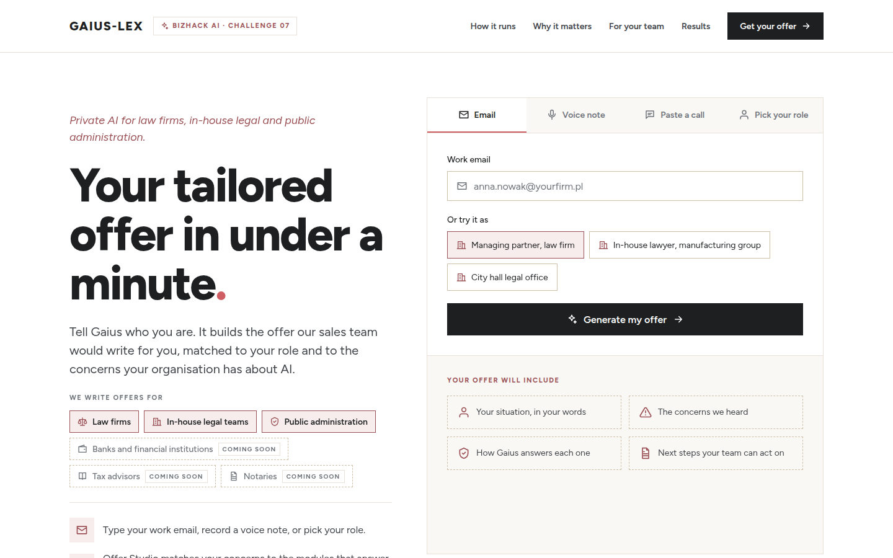
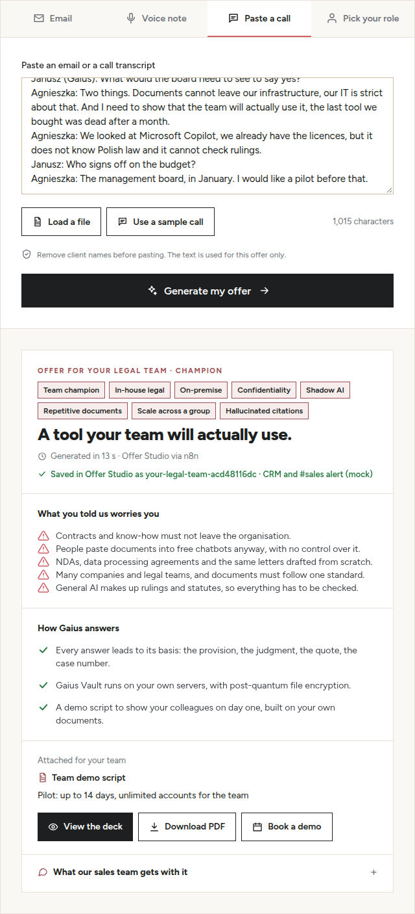
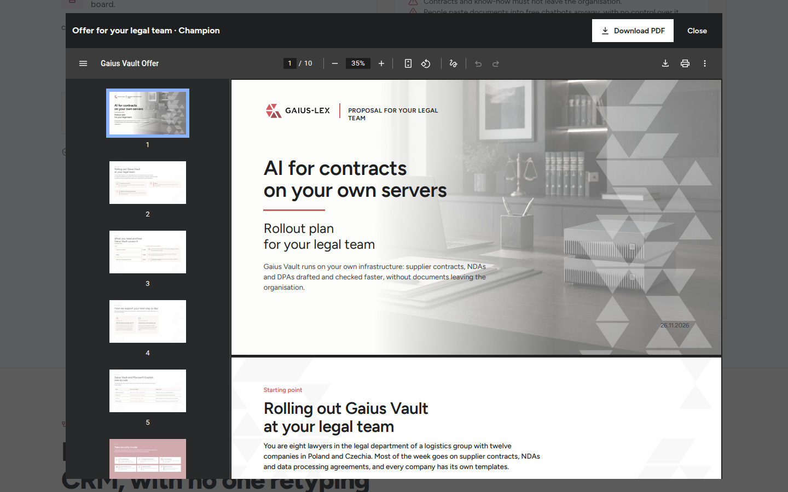
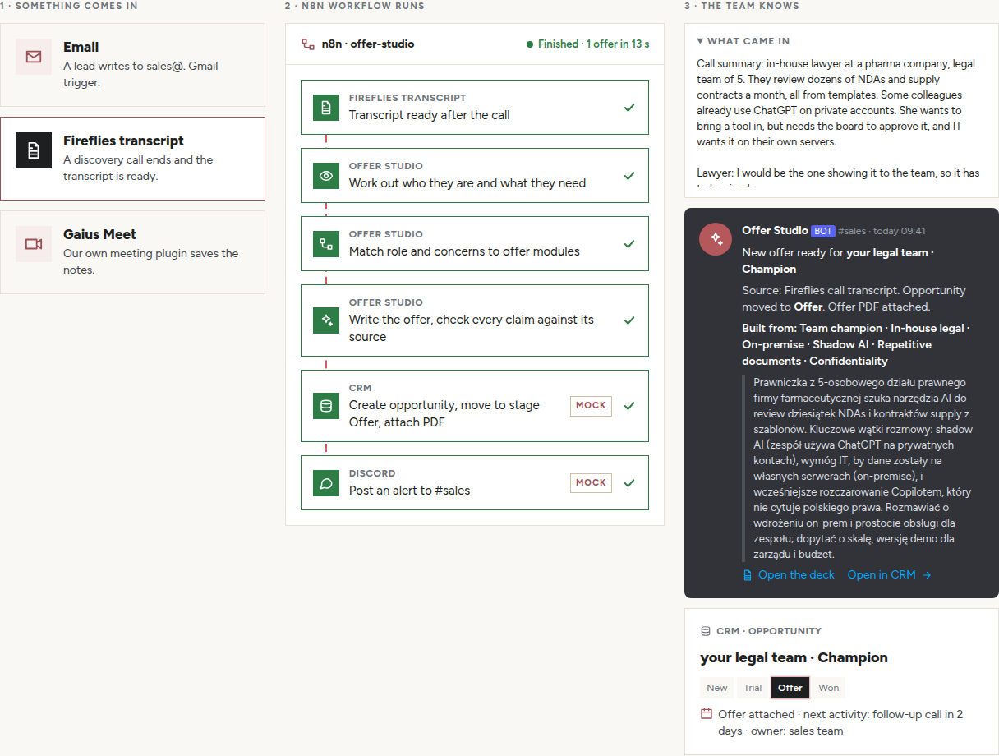
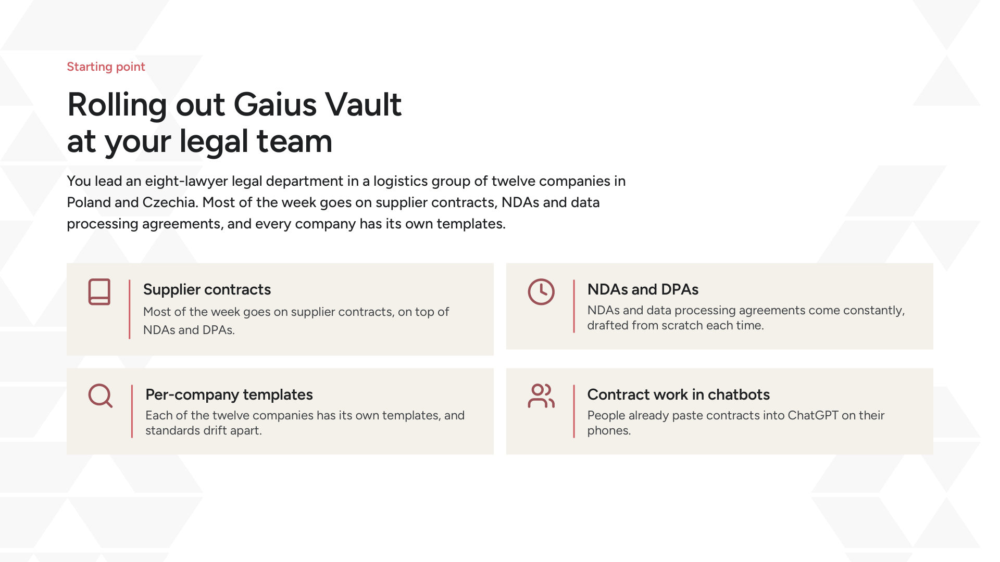
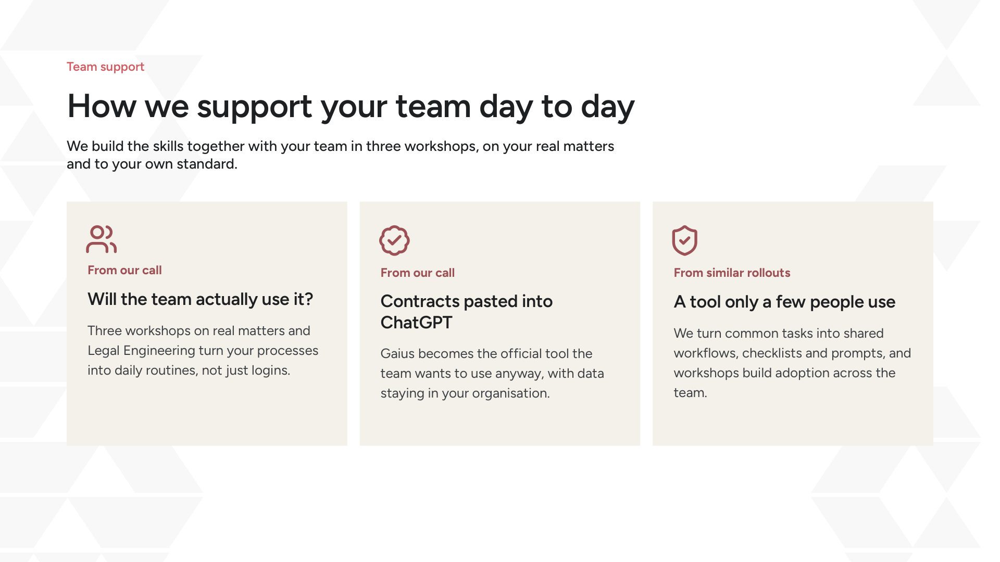
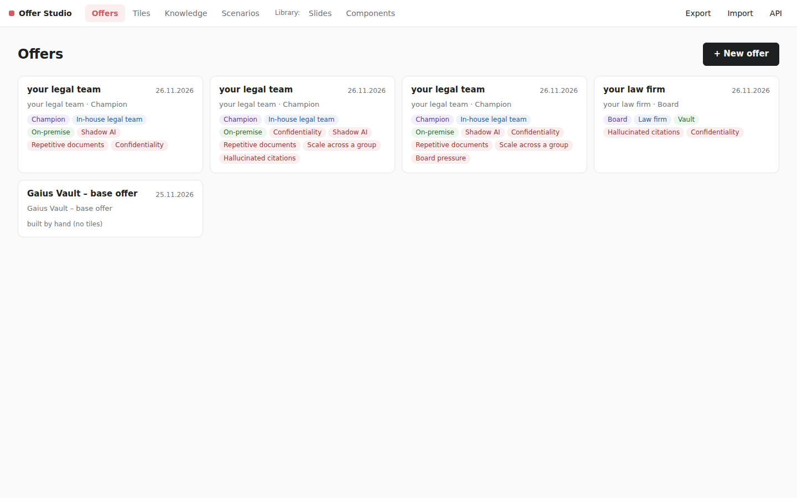
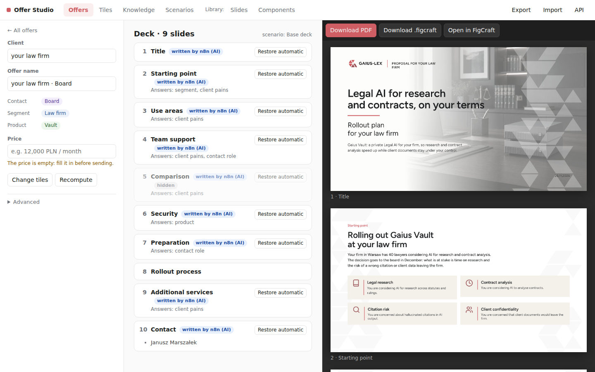
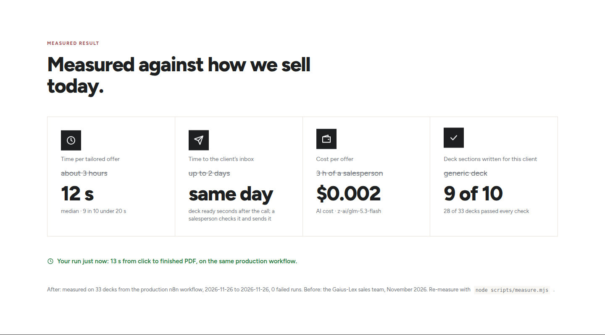
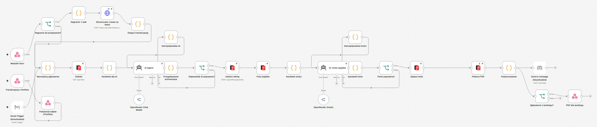

# Gaius-Lex Offer Studio: a tailored sales offer in under a minute

BizHack AI 2026, Challenge 07. A lead writes, talks or has a call with us; n8n turns it into a client-specific
Gaius-Lex deck (PDF) with copy written from what the client said, and the sales team gets it with a short note.

- **Live:** landing https://bizhack.trygaius.com · n8n https://n8n.bizhack.trygaius.com · Offer Studio https://studio.bizhack.trygaius.com
- **Measured** on the production workflow (`node scripts/measure.mjs`): median 12 s per deck instead of ~3 hours by hand,
  about $0.002 of AI per deck, 0 failed runs. Numbers on the landing come from `landing/src/lib/measured.json`.
- **What is mocked:** the CRM write and the Discord alert. The offer, the AI copy and the PDF are real.

## Try it

**No install:** open https://bizhack.trygaius.com, pick the "Paste a call" tab, click "Use a sample call" (or paste
your own email or notes) and "Generate my offer". The deck comes back in about 15 seconds.

**On your machine, one command** (Docker with Compose; Node 18+ is optional):

```bash
git clone https://github.com/GaiusSigma/bizhack2026.git && cd bizhack2026
./scripts/start.sh            # Windows: powershell -ExecutionPolicy Bypass -File scripts\start.ps1
```

It asks once for an [OpenRouter](https://openrouter.ai/keys) API key (the only thing you provide), builds and starts
the stack, waits until the offer workflow is live, generates two sample offers into `out/` and prints the addresses.
About 2½ minutes from `git clone` to the first deck on a fresh machine. Nothing to click or import: Offer Studio
starts with its knowledge base, tiles, scenarios and slide templates, and n8n imports and publishes the workflow
and creates its credentials by itself.

| What | Address | Login |
|---|---|---|
| Landing (generate an offer) | http://localhost:8080 | – |
| Offer Studio (the offers, knowledge, scenarios, slides) | http://localhost:8082 | any user name, password `studio` |
| n8n (the workflow and every run) | http://localhost:5678 | `demo@example.com` / `gaius-jury-2026` |
| FigCraft (slide editor) | http://localhost:8081 | – (Offer Studio ▸ Slides ▸ Edit in FigCraft opens the deck template) |

- Your own case: `node scripts/try-it.mjs --text-file my-call.txt` (an email, notes or a transcript; Polish or English).
  All samples: `node scripts/try-it.mjs`; the 10 graded test cases: `node scripts/try-it.mjs sample-data/eval/*.json`
  (results in [docs/EVAL.md](docs/EVAL.md)).
- A port already taken? Set `LANDING_PORT`, `STUDIO_PORT`, `N8N_PORT` or `FIGCRAFT_PORT` in `.env` and run `start.sh` again.
- Stop: `./scripts/stop.sh` (`--wipe` deletes the data too). The demo login and ports apply to local runs only
  (`docker-compose.local.yml`); production has its own accounts.
- By hand instead of the script: `cp .env.example .env`, set `OPENROUTER_API_KEY`, then
  `docker compose -f docker-compose.yml -f docker-compose.local.yml up -d --build`.

## What you will see

| | |
|---|---|
|  Landing: email, voice note, a pasted call or a role |  The offer: what it was built from, the client's concerns, the note for our sales team |
|  The deck, full screen in the browser |  "Run the workflow": the production workflow on a sample call |
|  Slide written from the call |  Concerns "From our call", with our answers |
|  Offer Studio: every offer, with its tiles |  An offer: which slides AI wrote, edit, recompute, PDF |
|  Measured on real runs | |


The n8n workflow: enquiry (website, Fireflies, Gmail, voice note) → tiles → AI plan → offer in Offer Studio →
AI copy, checked field by field → PDF → back to the landing and to the sales team.

## The stack

One `docker-compose.yml` with four apps, ready to deploy with **Coolify**:

| Service | What it is | Container port | Domain in Coolify |
|---|---|---|---|
| `landing` | Astro landing page, built statically and served by nginx | 80 | yes |
| `n8n` | n8n 2.50 (automations) with built-in Offer Studio nodes ([details](n8n/README.md)) | 5678 | yes |
| `n8n-runners` | External n8n task runners (JS and Python in Code nodes) | – | no |
| `postgres` | n8n database (Postgres 17) | 5432 | no |
| `figcraft` | FigCraft web version (WebAssembly) served by nginx + `/sync/` proxy | 80 | yes |
| `figcraft-server` | FigCraft collaboration server (file sharing, links, team list) | 47900 | no, reachable through `figcraft` at `/sync/` |
| `offer-studio` | Knowledge base + offer builder; FigCraft renders the slides, preview and PDF ([details](offer-studio/README.md)) | 3000 | yes |

```
.
├── docker-compose.yml          # production / Coolify
├── docker-compose.local.yml    # local overlay: ports on localhost, n8n over http
├── .env.example                # variables for running locally
├── landing/                    # Astro project + Dockerfile (node -> nginx) + nginx.conf
├── n8n/                        # n8n image + Offer Studio nodes (n8n-nodes-offer-studio)
├── offer-studio/               # offer dashboard: Node + SQLite + rendering via figcraft-cli
├── sample-data/                # sample enquiries (landing, voice note, pasted call, Fireflies), no real clients
├── scripts/                    # try-it.mjs (send enquiries, save decks), measure.mjs (numbers for the landing)
├── docs/DEMO.md                # the live demo script
└── figcraft/
    ├── web/                    # Dockerfile: official figcraft-web-<version>.zip + nginx
    └── server/                 # Dockerfile: official figcraft-server binary + entrypoint
```

## Working on the landing alone

With hot reload: `cd landing && npm install && npm run dev`.

## Deploying with Coolify

1. Push the repo to GitHub (or another Git host Coolify can see).
2. In Coolify: **New Resource → Public/Private Repository**, pick the repo and branch, choose
   **Docker Compose** as the **Build Pack**, file path: `/docker-compose.yml`.
3. Coolify reads the services. Set domains for `landing`, `n8n`, `figcraft` and `offer-studio`, e.g.:
   - `landing` → `https://bizhack.example.com`
   - `n8n` → `https://n8n.bizhack.example.com`
   - `figcraft` → `https://figcraft.bizhack.example.com`
   - `offer-studio` → `https://offers.bizhack.example.com`

   The ports are already encoded in the `SERVICE_URL_<SERVICE>_<PORT>` variable names, so Coolify
   routes traffic to the right container port by itself. Don't add `ports:` to the compose file:
   everything goes through the Coolify proxy with a Let's Encrypt certificate.
4. **Deploy.** Coolify generates the passwords (`SERVICE_USER_POSTGRES`, `SERVICE_PASSWORD_POSTGRES`,
   `SERVICE_PASSWORD_N8NRUNNERS`, `SERVICE_PASSWORD_64_N8NKEY`) on the first deployment and keeps them
   under Environment Variables.

> **The n8n encryption key** (`SERVICE_PASSWORD_64_N8NKEY`) encrypts the credentials stored in n8n.
> Back it up. If the key changes or is lost, n8n can no longer read its saved credentials.

The `n8n-data`, `postgres-data` and `figcraft-data` volumes are persistent and show up in Coolify under
**Persistent Storage**. Turning on database or full-server backups in Coolify is a good idea.

## FigCraft

- The `figcraft` image downloads the **official** `figcraft-web-0.18.1.zip` build from the
  [FigCraft releases](https://github.com/storytold/figcraft/releases) and checks its SHA-256.
  The `figcraft-server` image does the same with `figcraft-server-0.18.1-linux-<arch>.tar.gz`
  (amd64 and arm64).
- On start, the `figcraft` container writes
  `<meta name="figcraft-server" content="wss://<figcraft-domain>/sync/">` into `index.html`, so the
  browser app knows the collaboration server right away (Home ▸ Online, sharing, join codes).
- FigCraft is at an early stage (alpha). In the browser, files are stored locally;
  to work together, you publish them to the server.
- **Offer Studio slides are edited in the browser too**: Offer Studio ships the same web build at
  `<offer-studio-domain>/figcraft/` and opens library files in it (Slides ▸ Edit in FigCraft); Ctrl+S
  saves them straight back to the library. Details: [offer-studio/README.md](offer-studio/README.md).

### Publishing files to the server

By default (`FIGCRAFT_OPEN_PUBLISH=false`) only someone who knows the **server key** can publish files.
This command, run in the `figcraft-server` container (in Coolify: that service's **Terminal** tab),
prints the URL with the key:

```sh
figcraft-server --config /etc/figcraft-server/server.toml key
```

Paste that URL into FigCraft under Preferences as the server, or use it in Share ▸ Publish to server.
Treat it like a password.

Server settings (environment variables of the `figcraft-server` service):

| Variable | Default | Meaning |
|---|---|---|
| `FIGCRAFT_OPEN_PUBLISH` | `false` | `true` lets anyone publish without a key (public server) |
| `FIGCRAFT_TEAM_FILES` | empty (off) | Team file list: `edit`, `comment` or `view`. **Anyone** who can reach the server sees it, so turn it on deliberately on a public domain |
| `FIGCRAFT_MAX_FILE_MB` | `64` | Largest file in MiB |

### Upgrading FigCraft

In `figcraft/web/Dockerfile` and `figcraft/server/Dockerfile`, change `FIGCRAFT_VERSION` and the
SHA-256 checksums to the values from the new release's `SHA256SUMS.txt`. Offer Studio has its own copies:
`offer-studio/Dockerfile` (figcraft-cli) and `offer-studio/scripts/fetch-figcraft-web.mjs` (web build).

## n8n

- The setup follows the official Coolify "n8n with PostgreSQL" template: Postgres,
  external task runners (`n8nio/runners`), `N8N_PROXY_HOPS=1` behind the Coolify proxy.
- Webhooks are available at `https://<n8n-domain>/webhook/...`.
- The image built from `n8n/Dockerfile` ships the **Offer Studio** and **Offer Studio Trigger** nodes.
  Operations are read live from Offer Studio's `/api/openapi.json`, so new Offer Studio endpoints
  show up in n8n without a rebuild. n8n fills in the "Offer Studio API" credential by itself
  (URL and `SERVICE_PASSWORD_64_STUDIOAPI`). Details: [n8n/README.md](n8n/README.md).
- Upgrading: change `N8N_VERSION` (build argument of the `n8n` service) and the `n8nio/runners` tag
  (always the same version), then redeploy.
